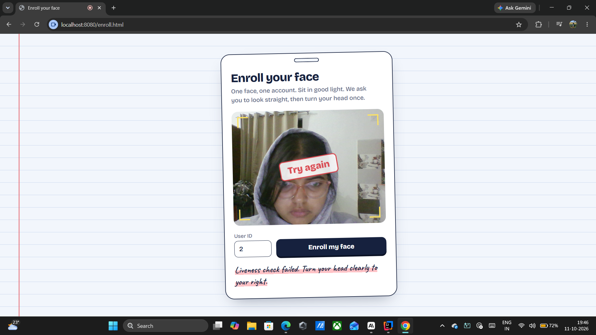

# Notes Platform: one face, one account

A college notes and PYQ (previous year question paper) sharing platform where **every account is tied to one real person's face**. Face recognition stops duplicate accounts, and a head-turn liveness check stops photo spoofing. Only face-verified users can upload or download notes.

## Demo




[Watch the 14-second demo](docs/demo.mp4)

## Why this project

Most notes-sharing apps are open to fake and duplicate accounts. This project solves that with face verification that runs fully on the server, without any third-party face API.

## Features

- **Face enrollment**: face detected with OpenCV (YuNet), converted to an embedding with SFace, and stored in PostgreSQL. Only the embedding is stored, never the photo.
- **One face, one account**: a new enrollment is compared with every enrolled face. A match above the threshold is rejected.
- **Liveness check**: the server picks a random challenge (turn left or right) and issues a one-time token. The user sends a straight photo and a turned photo, and the server verifies the head yaw. A printed or phone photo cannot do a real head turn, so it fails.
- **Face login**: 1-to-1 match against the stored face of that user ID, after liveness passes. Failure message is generic, so user IDs cannot be probed.
- **Notes and PYQ sharing**: upload, list, search, filter and download. All endpoints need a face-login session.
- **Safe uploads**: allowed extensions only (pdf, png, jpg, jpeg, docx, pptx), size limit, and random server-side file names.
- - **AI note summary**: one click gives a short summary of PDF and DOCX notes using the Gemini API. The summary is saved in the database, so each note is summarized only once.

## How it works

```
Enroll / Login
  1. GET  /api/face/liveness/challenge   -> random LEFT or RIGHT + one-time token
  2. Browser captures: straight photo, then turned photo
  3. POST /api/face/enroll-live  or  /api/face/login-live
       token valid? -> same person in both photos? -> liveness (yaw) ok?
       -> enroll: duplicate-face check, then save embedding
       -> login: match with stored embedding, then create session
Notes (session required)
  POST /api/notes/upload, GET /api/notes, GET /api/notes/{id}/download
  POST /api/notes/{id}/summary -> text extracted (PDF/DOCX) -> Gemini -> summary saved in DB

The order of checks matters: liveness always runs **before** any account lookup, so an attacker without a live face learns nothing about which IDs exist.

## Tech stack

- Java, Spring Boot, Spring Data JPA (Hibernate)
- PostgreSQL
- OpenCV (Java bindings), YuNet face detector, SFace face recognition model
- HTML, CSS and vanilla JavaScript (camera via `getUserMedia`)
- Gemini API, Apache POI

## Setup

1. Install JDK 17 or newer and PostgreSQL. Create a database named `notesapp`.
2. Create `src/main/resources/application-local.properties` (this file is git-ignored):
   ```properties
   spring.datasource.password=YOUR_POSTGRES_PASSWORD
   ```
3. Check `application.properties` for the datasource URL (`jdbc:postgresql://localhost:5432/notesapp`) and username.
4. Make sure the YuNet and SFace `.onnx` model files are in `src/main/resources/models/`.

5. Get a free Gemini API key from Google AI Studio and set it:
   - Windows: `setx GEMINI_API_KEY "your_key"` (then reopen the terminal/IDE)
   - Or add `gemini.api-key=your_key` to `application-local.properties`

6. Run:
   ```
   ./mvnw spring-boot:run
   ```
7. Open:
    - `http://localhost:8080/enroll.html` to enroll a face
    - `http://localhost:8080/login.html` to log in with the face
    - `http://localhost:8080/notes.html` for the notes page (needs login)


## Testing done (manual)

| Scenario | Expected | Result |
|---|---|---|s
| Correct head turn | Enrolled / logged in | Pass |
| Turn the wrong way | Rejected | Pass |
| No head turn | Rejected | Pass |
| Phone photo instead of live face | Rejected | Pass |
| Same face on a second account | Rejected as duplicate | Pass |
| Face login on an un-enrolled ID | Generic failure | Pass |
| Notes page / API without login | 401 / redirect to login | Pass |

## Limitations (honest list)

- A high-quality video replay or a 3D mask could still fool a single head-turn challenge. A stronger version would add texture or depth-based anti-spoofing and more than one challenge.
- User IDs are plain numbers and there is no separate signup or password. Anyone can enroll an unused ID, so face login proves "same person as the enrolled face", not "the right student of this college". A real deployment should link enrollment to a verified account (college email or ID).
- Match thresholds were tuned on a very small number of people and webcams. Lighting, glasses and hoods can cause false rejects.
- Face embeddings are biometric data and are stored unencrypted. Production use needs encryption, consent and a delete option.
- Sessions are in-memory, and there is no rate limiting on login attempts yet.

## Future work

- Account signup tied to college email, with face as a second factor
- Rate limiting and lockout on failed face logins
- Delete my face data, and delete my own uploads
- More challenges (blink, smile) and a random sequence
- Encrypt embeddings at rest

## Project structure

```
src/main/java/.../FaceController.java    enroll-live, login-live, challenge
src/main/java/.../FaceService.java       detection, embeddings, similarity
src/main/java/.../LivenessService.java   challenges, tokens, yaw check
src/main/java/.../NoteController.java    upload, list, download (session protected)
src/main/resources/static/               enroll.html, login.html, notes.html
```